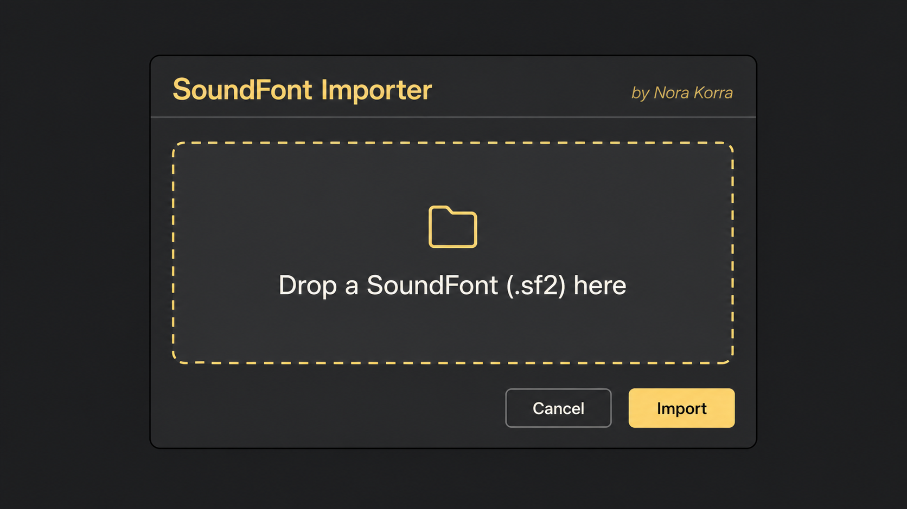

# SoundFont Importer by Nora Korra

Convert .sf2 SoundFonts into native Ableton Live Sampler presets and restore functionality removed from Ableton Live 11.

SoundFont Importer extracts samples, preserves instrument mappings and creates a browsable preset collection inside Ableton Live.

Ableton Live supported SoundFont import in older versions, but this functionality was removed in Live 11. SoundFont Importer brings native .sf2 import back through Ableton’s Extensions system.

> This project uses Ableton’s Extensions SDK, which may still change while the SDK itself remains in beta.



## Download

Download the ready-to-install `.ablx` file from the [latest GitHub release](https://github.com/norakorra/soundfont-importer/releases/latest).

You do not need to download or build the source code to install the extension.

## Requirements

- Ableton Live with Extensions support
- Ableton Sampler installed and licensed, normally included with Live Suite
- A legally obtained `.sf2` SoundFont

## Installation

1. Download `SoundFont-Importer-v1.0.0.ablx` from the latest release.
2. Open Ableton Live.
3. Open **Settings > Extensions**.
4. Drag the `.ablx` file onto **Drag & Drop to Install**, or use **Choose File**.
5. Restart Ableton Live after installation.

## Using the importer

1. Right-click a supported track, clip, device, scene, or browser context in Live.
2. Select **Import SoundFont (.sf2)**.
3. Drop an `.sf2` file into the importer window.
4. Click **Import** and wait for conversion to finish.
5. Add the generated **SoundFont Imports** folder to Places in Live's Browser when prompted.

Each usable SoundFont patch becomes an Ableton Sampler `.adv` preset. Extracted AIFF samples are kept alongside the generated collection so the presets can find their source audio.

## Why this exists

Ableton Live supported direct SoundFont import in earlier versions of Sampler, but this feature disappeared in Live 11. SoundFont Importer restores that workflow by converting .sf2 files into native Sampler presets that can be browsed directly inside Ableton Live.

## What is preserved

- Patch, bank, and program structure
- Key and velocity zones
- Root-key mapping
- Original sample rate
- Loop points and loop-enabled state
- Multiple samples and zones per patch

## Important notes

- The extension does not include any SoundFonts.
- Importing a large SoundFont can take time and use significant disk space.
- SoundFont compatibility can vary because `.sf2` files differ in how they use generators and modulators.
- Keep the generated samples with their presets. Moving or deleting them can make presets lose their audio references.
- You are responsible for the licence terms of every SoundFont you convert.

## Version

Current extension version: **1.0.0**

See [CHANGELOG.md](CHANGELOG.md) for release details.

SoundFont Importer follows semantic versioning:

- `1.0.1` for bug fixes
- `1.1.0` for new backwards-compatible features
- `2.0.0` for major or breaking changes

## Building from source

Package the extension with Python 3:

```bash
python3 package_ablx.py extension-package SoundFont-Importer-v1.0.0.ablx
```

The standalone converter can also extract a SoundFont to WAV files plus a normalized `bank.json` manifest:

```bash
PYTHONPATH=prototype python3 -m sf2_to_simpler_bank /path/to/file.sf2 /path/to/output-folder --pretty
```

Repository structure:

- `extension-package`: Ableton Extensions SDK package source
- `prototype/sf2_to_simpler_bank`: standalone Python converter
- `package_ablx.py`: `.ablx` packaging tool
- `smoke_convert.js`: JavaScript conversion smoke test
- `ablx-format-notes.md`: format and SDK research notes

Generated `.ablx` files and converted sample banks are intentionally excluded from version control.

## Licence

Copyright © 2026 Aaron Werinussa. All rights reserved. See [LICENSE.txt](LICENSE.txt).
